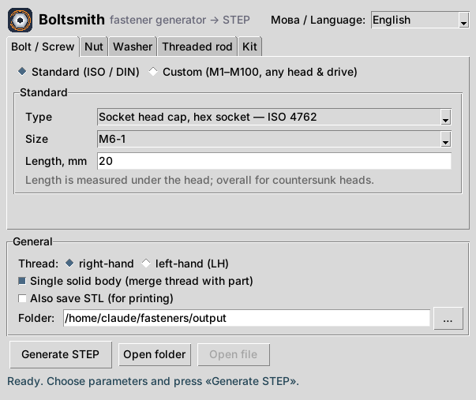
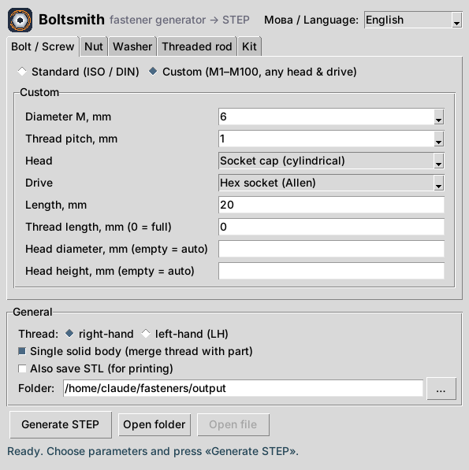
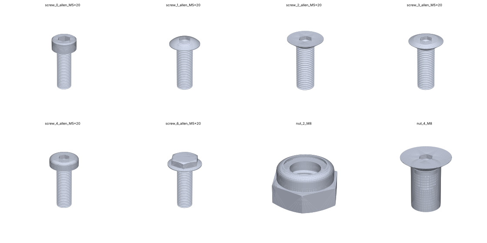
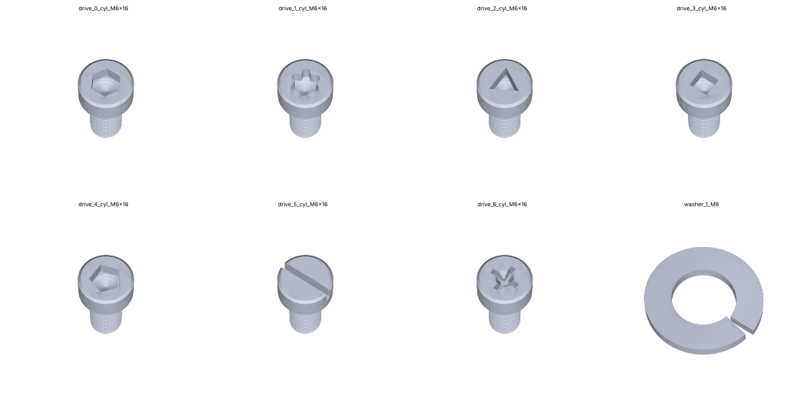
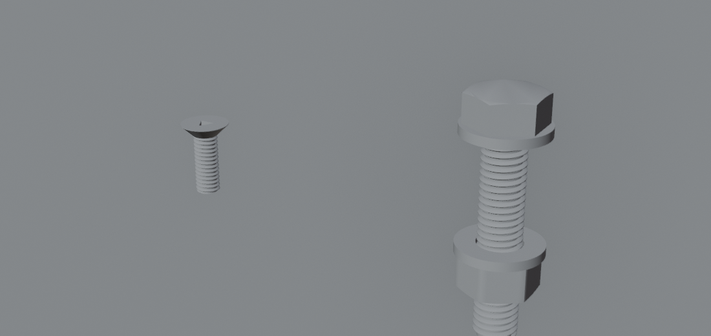

  

<h1 align="center">Boltsmith</h1>

  <b>Fastener generator with real helical threads → STEP / STL</b> 
  Bolts, screws, nuts, washers, threaded rods and ready-made bolt kits — for CAD assemblies, 3D printing and rendering. 
  Windows · macOS · Linux · Blender add-on

---

Tired of hunting for "M5×16 countersunk Torx, left-hand" on download sites? Boltsmith builds it for you in seconds,
with **real ISO threads** (not a texture, not a cosmetic cylinder) — as a clean solid body you can drop straight into
Fusion 360, SolidWorks, FreeCAD, Onshape or any CAD that reads STEP.

  
  

## Features

### Bolts & screws
- **Standard mode** — 26 ISO / DIN types with exact dimension tables:
  socket head cap (ISO 4762), cheese head, button head (ISO 7380), countersunk (ISO 10642, 2009, 7046, 14581/14582),
  raised countersunk, hex head (ISO 4017 / 4014, DIN 931), hex flange (DIN 1665 / 1662), pan head (ISO 1580, 14583, 7045),
  set screws (ISO 4026), shoulder screws (ISO 7379) — hex socket, Torx, slotted and Phillips drives.
- **Custom mode** — any size **M1 to M100**, any pitch, any combination of:
  - head: socket cap, button/dome, countersunk 90°, raised countersunk, pan, hex, hex flange, headless (set screw)
  - drive: hex socket, Torx, **triangle**, **square (Robertson)**, **pentagon**, slot, cross (Phillips)
  - optional partial thread length and manual head dimensions

  
  

### Nuts
- Standard: hex (ISO 4032 / 4033), thin/jam (ISO 4035), unchamfered (ISO 4036), flange (DIN 1665),
  domed cap / acorn (DIN 1587), square (DIN 557), **heat-set inserts for 3D printing** (McMaster-Carr, CNC Kitchen, ruthex, Hilitchi)
- Custom (M1–M100): hex, thin, **nylon-insert lock nut** (ISO 7040, insert as a separate body),
  **furniture sleeve nut** (flat or countersunk head, any drive), coupling nut (DIN 6334)

### Washers, rods, kits
- Washers: ISO 7089 / 7090 / 7091 / 7092 / 7093 / 7094, internal tooth lock washer (DIN 6797),
  custom flat washers and **spring lock washers** (DIN 127, real helical shape)
- Threaded rod (DIN 975) of any size and length
- **Kit** — bolt + nut + washers positioned for a given grip thickness, each part a separate body: drop a ready joint into your assembly

### Everywhere
- Right-hand or **left-hand** threads
- Single solid body (thread merged with the part) for clean CAD work
- Optional STL export for 3D printing
- English / Ukrainian interface, switchable in the window

## Blender add-on

The same generator inside Blender (4.2+ / 5.x): **3D Viewport → Sidebar (N) → Boltsmith**.
Parts appear at the 3D cursor in the correct scale (mm, respects the scene unit scale), smooth-shaded;
kits are separate objects under one Empty. Mesh density Low / Medium / High, optional STEP export,
non-blocking generation (Esc cancels).

The add-on is tiny (~70 KB): the CAD kernel runs **outside** Blender through [uv](https://docs.astral.sh/uv/),
so nothing heavy is installed into Blender's Python. If uv is missing, the panel offers a one-click install.

## Download & install

Grab the files for your system from **[Releases](../../releases)**.

| System | How |
|---|---|
| **Windows** | Unzip anywhere → run `Create_Shortcut.bat` once (adds *Boltsmith* to the Desktop and Start menu) → start from the shortcut. `Fastener_Generator.bat` starts it with a console for troubleshooting. |
| **macOS** | Unzip `Boltsmith_mac.zip` **on the Mac** → drag `Boltsmith.app` to Applications → first start: right-click → **Open** (the app is not signed by Apple). If macOS says it is "damaged": `xattr -dr com.apple.quarantine /Applications/Boltsmith.app` |
| **Linux** | Unzip → `bash install_linux.sh` (downloads the CAD kernel, adds Boltsmith to the app menu and Desktop) → start from the menu or `./boltsmith.sh`. Requires `curl`. |
| **Blender** | Drag `boltsmith_blender_x.y.z.zip` into Blender, or *Edit → Preferences → Get Extensions → ⌄ → Install from Disk*. |

**First start** downloads the CAD kernel (OpenCascade via build123d, a few hundred MB) once into the uv cache;
afterwards everything starts in seconds and works offline. The desktop app and the Blender add-on share the same cache.

Output: `output/` next to the program (Windows/Linux) or `~/Documents/Boltsmith/output` (macOS).

## How it works

- Standard fasteners come from the dimension tables of [bd_warehouse](https://github.com/gumyr/bd_warehouse).
- Custom fasteners are parametric models with dimensions close to ISO/DIN formulas.
- Geometry is built with [build123d](https://github.com/gumyr/build123d) on the [OpenCascade](https://dev.opencascade.org/) kernel:
  external threads are fused helical solids, internal threads are cut ("tapped") with a bolt-shaped tool —
  which keeps the boolean operations robust from M1 to M100.

## Known limitations

- Threads use the nominal ISO profile **without fit tolerances**. For 3D-printed nuts and holes, add clearance in your slicer or scale slightly.
- Custom-mode dimensions are formula-based approximations — use Standard mode when you need exact ISO/DIN sizes.
- Torx and Phillips recesses in Custom mode are simplified (realistic, but not to the drive standard).
- For a few types (countersunk Torx ISO 14581 / 14584) the kernel cannot always merge the thread into the body:
  you get two bodies — use *Combine* in your CAD.
- The macOS app is not code-signed (see install notes above).

## Credits

Built on the shoulders of [build123d](https://github.com/gumyr/build123d) and [bd_warehouse](https://github.com/gumyr/bd_warehouse)
by Roger Maitland (Apache-2.0), [OCP / OpenCascade](https://github.com/CadQuery/OCP), and [uv](https://github.com/astral-sh/uv) by Astral.

## License

GPL-3.0-or-later (required for Blender add-ons). Third-party libraries keep their own licenses.

## Feedback

Found a wrong dimension or need a fastener type? Open an **[Issue](../../issues)** — screenshots and the STEP file help a lot.
